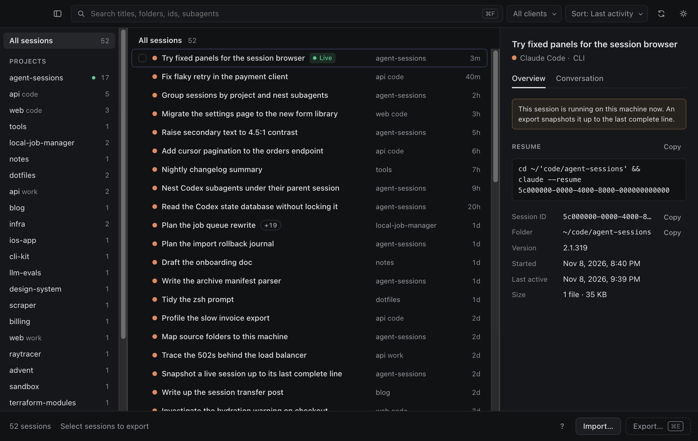

<h1 align="center">Agent Sessions</h1>

Move your Claude Code and Codex sessions to another computer, and pick up where you left off.

<a href="https://github.com/karlhsueh/agent-sessions/releases/latest"><strong>Download for macOS, Windows, or Linux</strong></a>

## What it does

Coding agents keep each session on the machine where it ran. Agent Sessions lists the Claude Code and Codex sessions on this computer, exports the ones you pick into one `.agentsessions` file, and imports that file on another computer. After the import, `claude --resume` or `codex resume` continues the conversation there, with its full history.

- **Browse by project.** A sidebar lists your project folders. Search titles, folders, and session ids. Preview the conversation before you export it.
- **Map folders.** Your code may live at a different path on the other computer. Import asks where each project lives there, and can create a folder that is missing.
- **Safe import.** Nothing is written until you start the import. An import that fails partway rolls back, and replacing an existing session keeps a backup of the old copy.
- **Subagents included.** Sessions that started subagents carry them along.
- **Local only.** The app makes no network requests. You move the file however you like.

## Before you share an archive

An archive holds each full transcript, unredacted: the account email recorded in the session, system prompts, every message, and the contents of files and command output the agent read. Credentials, auth tokens, and settings are never included. Treat the file like the code it quotes. [SECURITY.md](SECURITY.md) has more.

After an import, the app shows the resume command for each session. It checks that the files are where the agent looks for them, but it cannot start the agent to confirm that the session opens.

## Install

Get the installer for your system from the [latest release](https://github.com/karlhsueh/agent-sessions/releases/latest):

| System | File |
| --- | --- |
| macOS, Apple silicon | `agent-sessions-<version>-mac-arm64.dmg` |
| macOS, Intel | `agent-sessions-<version>-mac-x64.dmg` |
| Windows x64 | `agent-sessions-<version>-win-x64.exe` |
| Linux x64 | `.AppImage`, or `.deb` for Debian and Ubuntu |

Each release lists the SHA-256 of every file in `SHA256SUMS`. The macOS app is signed and notarized. The Windows and Linux builds are not code-signed, so Windows SmartScreen asks you to confirm the first launch.

## Supported agents

| Agent | Where sessions live | Resume after import |
| --- | --- | --- |
| Claude Code | `~/.claude/projects`, or `CLAUDE_CONFIG_DIR` | `claude --resume <id>` from the mapped folder |
| Codex | `~/.codex/sessions`, or `CODEX_HOME` | `codex resume <id>` |

The app works with what each CLI writes to disk. A new CLI version can change that format, so if a session does not list or resume, please [open an issue](https://github.com/karlhsueh/agent-sessions/issues) with both CLI versions.

## Contributing

Built with Electron, React, and TypeScript. [CONTRIBUTING.md](CONTRIBUTING.md) covers setup, the docs to read first, and the test commands.

## License

[MIT](LICENSE). Agent Sessions is an independent project and is not affiliated with Anthropic or OpenAI.
