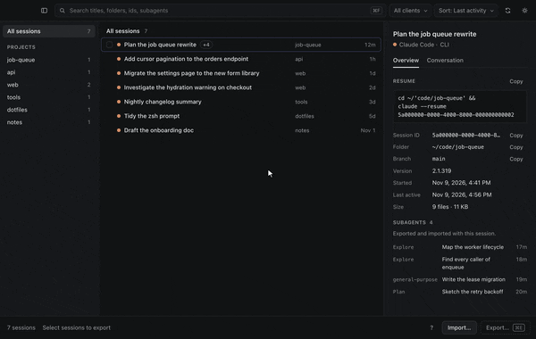

<p align="center"></p>

<h1 align="center">Agent Sessions</h1>

<p align="center">Move your Claude Code and Codex sessions to another computer, and pick up where you left off.</p>

<p align="center"><a href="https://github.com/karlhsueh/agent-sessions/releases/latest"><strong>Download for macOS, Windows, or Linux</strong></a></p>

<p align="center"><sub>Early release. Expect rough edges, and please <a href="https://github.com/karlhsueh/agent-sessions/issues/new/choose">report what breaks</a>.</sub></p>

<p align="center"></p>

## What it does

Coding agents keep each session on the machine where it ran. Agent Sessions lists the Claude Code and Codex sessions on this computer, exports the ones you pick into one `.agentsessions` file, and imports that file on another computer. After the import, `claude --resume` or `codex resume` continues the conversation there, with its full history.

- **Browse by project.** A sidebar lists your project folders. Search titles, folders, and session ids. Preview the conversation before you export it.
- **Map folders.** Your code may live at a different path on the other computer. Import asks where each project lives there, and can create a folder that is missing.
- **Safe import.** The app writes nothing until you start the import. An import that fails partway rolls back, and replacing an existing session keeps a backup of the old copy.
- **Subagents included.** An export includes the subagents each session started.
- **Local only.** Your sessions never leave this computer unless you move the archive yourself. The only network request is the check for a new version on GitHub.

The archive moves conversations, not code. Push your changes before you export and pull them on the other computer before you resume, or copy the project folder if it is not in git. A session resumed in an empty or outdated folder reads and edits the wrong files.

## Before you share an archive

An archive holds each full transcript, unredacted: the account email recorded in the session, system prompts, every message, and the contents of files and command output the agent read. The app never includes credentials, auth tokens, or settings. Treat the file like the code it quotes. [SECURITY.md](SECURITY.md) has more.

After an import, the app shows the resume command for each session. It checks that the files are where the agent looks for them, but it cannot start the agent to confirm that the session opens.

## After the move

The export leaves the sessions on the old computer, and the app does not delete them. Once each session resumes on the new computer, you can remove the old copies with the agent's own commands. Each command takes the session id that the app shows.

- **Codex.** `codex archive <id>` hides a session and `codex unarchive <id>` brings it back. `codex delete <id>` removes it for good.
- **Claude Code.** `claude purge <project folder>` deletes all of one project's sessions, tasks, and file history. Add `--dry-run` to see the list first. Claude Code has no command that deletes a single session. To remove one, delete `<id>.jsonl` and the `<id>` folder next to it in the project's folder under `~/.claude/projects`, and `~/.claude/file-history/<id>`.

Then delete the `.agentsessions` file on both computers. When an import replaced a session that was already there, the new computer kept the old copy in the app's `backups` folder: `~/Library/Application Support/agent-sessions` on macOS, `%APPDATA%\agent-sessions` on Windows, and `~/.config/agent-sessions` on Linux. Delete that folder once you no longer need the old copies.

## Install

**macOS** with [Homebrew](https://brew.sh):

```sh
brew install --cask karlhsueh/tap/agent-sessions
```

Or download the installer for your system. These links always fetch the latest release:

- macOS 13 or later on Apple silicon: [dmg](https://github.com/karlhsueh/agent-sessions/releases/latest/download/agent-sessions-mac-arm64.dmg)
- Windows: [x64 installer](https://github.com/karlhsueh/agent-sessions/releases/latest/download/agent-sessions-win-x64.exe)
- Linux: [AppImage](https://github.com/karlhsueh/agent-sessions/releases/latest/download/agent-sessions-linux-x86_64.AppImage) · [deb](https://github.com/karlhsueh/agent-sessions/releases/latest/download/agent-sessions-linux-amd64.deb) for Debian and Ubuntu

The macOS app is signed and notarized. The Windows and Linux builds are not code-signed yet, so Windows SmartScreen asks you to confirm the first launch. On Linux, run `chmod +x` on the AppImage before you open it. Each [release](https://github.com/karlhsueh/agent-sessions/releases/latest) lists the SHA-256 of every file in `SHA256SUMS`.

### Updates

From version 0.1.4, the app checks GitHub for a new release when it opens and every 4 hours. When one exists, the status bar shows **Update to** and the version. Nothing downloads until you click it. After the download, click **Restart to update** to install it. Ignore the button and you stay on your version. To check now, choose **Check for Updates…** in the app menu on macOS, or in the Help menu on Windows and Linux. On Linux, only the AppImage and the deb update themselves, and the deb asks for your password.

Versions before 0.1.4 cannot update themselves. Run `brew upgrade --cask agent-sessions`, or download the installer again and install it over the old version.

## Supported agents

| Agent | Where sessions live | Resume after import |
| --- | --- | --- |
| Claude Code | `~/.claude/projects`, or `CLAUDE_CONFIG_DIR` | `claude --resume <id>` from the mapped folder |
| Codex | `~/.codex/sessions`, or `CODEX_HOME` | `codex resume <id>` |

The app works with what each CLI writes to disk. A new CLI version can change that format, so if a session does not list or resume, please [open an issue](https://github.com/karlhsueh/agent-sessions/issues) with both CLI versions.

## Support

One person maintains Agent Sessions in their spare time. [Open an issue](https://github.com/karlhsueh/agent-sessions/issues/new/choose) for a bug or an idea, with the app version and the `claude --version` or `codex --version` output. Leave out transcript text. Report security problems privately, as [SECURITY.md](SECURITY.md) describes.

## Contributing

Agent Sessions uses Electron, React, and TypeScript. Bug fixes are welcome. For a feature or another agent, open an issue first. [CONTRIBUTING.md](CONTRIBUTING.md) covers setup, the docs to read first, and the test commands.

## License

[MIT](LICENSE). Agent Sessions is an independent project and is not affiliated with Anthropic or OpenAI.
