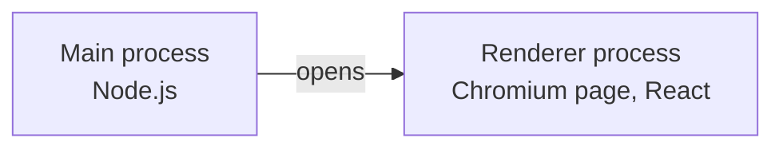
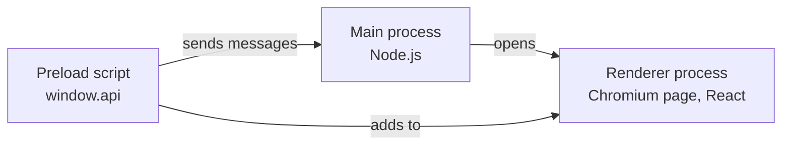
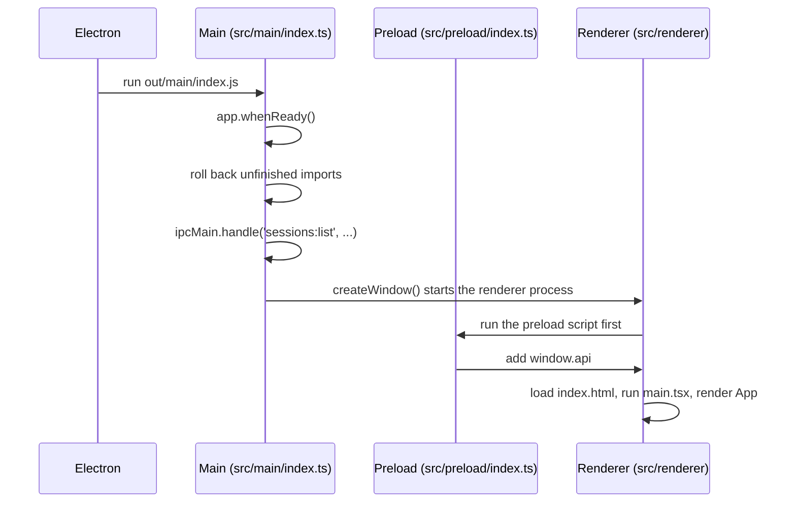
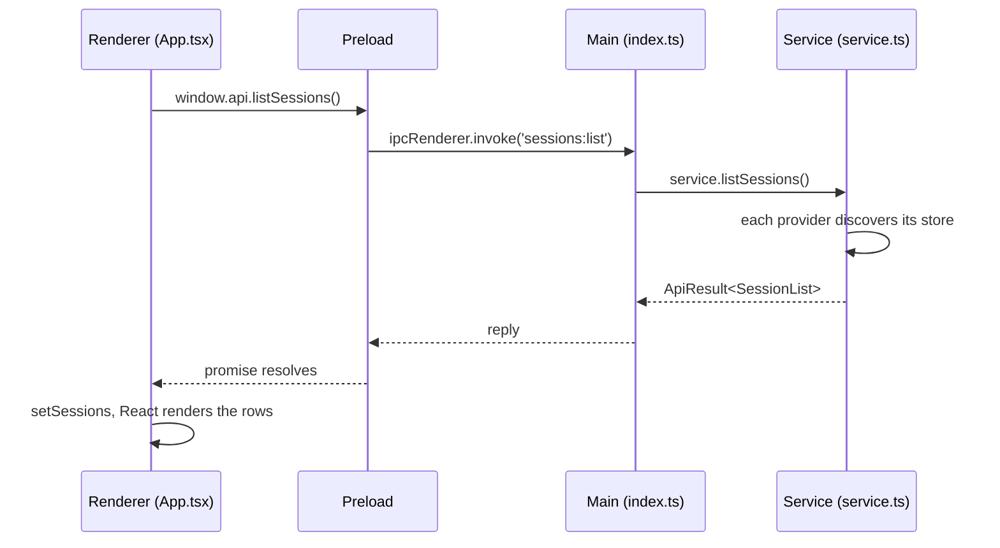

# How the app works

Electron is a Chromium browser and a Node.js runtime packaged as one desktop app. The page you see runs in the browser half. Anything that touches the machine, such as reading a session file, runs in the Node half. Most of what makes Electron different from a website is how those two halves talk to each other, so this doc follows one message through the app: the call that fills the session list.

## Electron runs your code in separate processes

The app starts in the **main process**. It is a Node.js program with full access to the machine, and it owns the app lifecycle and the windows. `src/main/index.ts` is its entry point.

The main process opens a `BrowserWindow`. Chromium then starts a **renderer process** to show the page in that window. The renderer is a web page. `src/renderer/` holds that page, and React runs there.



The two are operating system processes, so they share no memory. A variable in one does not exist in the other. In the page, `typeof process` and `typeof require` are both `undefined`, and the smoke test checks that.

The renderer has no Node because of three settings in `createWindow`. `sandbox: true` and `nodeIntegration: false` keep Node out of the page. `contextIsolation: true` keeps the preload script's JavaScript separate from the page's JavaScript. These settings matter because a page can run code you did not write. A session title is text from a transcript, and a bug that rendered it as HTML would run it. With these settings, that bug still cannot read the user's files.

## The preload script connects the two sides

The page still needs to ask main for things. The **preload script** in `src/preload/index.ts` runs in the renderer process before the page loads, and it can use a small set of Electron APIs that the page cannot. It adds one object, `window.api`, to the page.



`window.api` has a fixed set of functions. Eight move sessions or show what they hold, and are described in [Moving sessions between machines](transfer.md). Five more help the page: `storeRoots`, `chooseFolder`, `revealExport`, `copyText`, and `homeDir`, which lets the page show paths as `~/…`. The preload script never gives the page `ipcRenderer` itself. If it did, the page could send any message on any channel, and the sandbox would protect much less. Each function on `window.api` is a capability you chose to grant, and the smoke test fails if an undeclared key appears.

## Follow the code from launch to the first list

This section traces the code in the order it runs. Each step names the file and function, so you can open them side by side.

### Startup



1. `pnpm start` builds the app and starts Electron in the project folder. Electron reads `"main": "./out/main/index.js"` in `package.json`. That file is the compiled `src/main/index.ts`.

2. The top level of `src/main/index.ts` only registers callbacks. Electron cannot create windows until it is ready, so the work waits for `app.whenReady()`:

	```ts
	app.whenReady().then(async () => {
	  const context: CoreContext = { providers, env: { homeDir: homedir(), ... }, appDataDir: app.getPath('userData'), ... }
	  for (const result of await recoverJournals(join(context.appDataDir, 'journal'), providers)) { ... }
	  await clearStaging(context.appDataDir)
	  const service = createSessionService(context)
	  registerSessionHandlers(service)
	  registerShellHandlers(context)
	  createWindow()
	  ...
	})
	```

	An import that crashed halfway left a journal behind, so `recoverJournals` rolls it back first. The handlers are registered next, before the window exists, so they are in place before any page code can call them.

3. `createWindow` creates the window and names the preload script:

	```ts
	const window = new BrowserWindow({
	  width: 1200,
	  height: 760,
	  ...
	  webPreferences: {
	    preload: join(__dirname, '../preload/index.js'),
	    contextIsolation: true,
	    sandbox: true,
	    nodeIntegration: false,
	  },
	})
	```

	On macOS the window uses `titleBarStyle: 'hiddenInset'`, so the page draws its own title bar beside the traffic lights. The page then loads. Under `pnpm dev` it comes from the Vite dev server at `ELECTRON_RENDERER_URL`. In a built app it comes from `out/renderer/index.html` on disk.

4. Chromium starts a renderer process for the window. Before any page script runs, the renderer runs `src/preload/index.ts`:

	```ts
	const api: DesktopApi = {
	  listSessions: () => ipcRenderer.invoke(CHANNELS.listSessions),
	  ...
	}

	contextBridge.exposeInMainWorld('api', api)
	```

	After this line, `window.api.listSessions` exists in the page.

5. The renderer loads `src/renderer/index.html`. It applies the Content Security Policy, loads the stylesheets in `src/renderer/src/styles/`, and runs `main.tsx`, which mounts React:

	```ts
	createRoot(document.getElementById('root')!).render(
	  <StrictMode>
	    <App />
	  </StrictMode>,
	)
	```

6. React calls the `App` function in `App.tsx` for the first time. The `sessions` state starts as `{ status: 'loading' }`, so the page shows **Reading session stores…**. Under `pnpm dev`, `StrictMode` calls `App` twice to catch side effects. That is expected and does not happen in a built app.

### One call

After that first render, React runs the effect in `App` that loads the list.



1. The effect calls `loadSessions`:

	```ts
	const loadSessions = useCallback(async (): Promise<SessionList | null> => {
	  const result = await window.api.listSessions()
	  setSessions(result.ok ? { status: 'ready', value: result.value } : { status: 'failed', error: result.error })
	  return result.ok ? result.value : null
	}, [])
	```

2. `window.api.listSessions()` is the function from the preload script. It calls `ipcRenderer.invoke('sessions:list')`. IPC means inter-process communication. Electron copies the arguments into a message and sends it to the main process. `invoke` returns a promise right away, so `loadSessions` pauses at `await`.

3. In the main process, Electron finds the handler that `registerSessionHandlers` registered for `'sessions:list'`:

	```ts
	ipcMain.handle(CHANNELS.listSessions, () => service.listSessions())
	```

	The handler's first argument is the event, which says which window sent the message. This handler does not need it. The export and open handlers use it to show their dialogs over the right window.

4. `service.listSessions()` in `src/main/service.ts` calls `listSessions(context)` in `src/main/core/export.ts`. That function asks each provider in the registry to discover its store. The Claude Code provider reads `$CLAUDE_CONFIG_DIR`, or `~/.claude` when that is unset. A store that throws goes into `problems`, and the other stores are still listed. The service wraps the list as `{ ok: true, value }`, or turns an exception into `{ ok: false, error: { code, message } }`. It never throws across the boundary.

5. Electron copies the returned object back to the renderer. The `invoke` promise resolves, the `await` finishes, and `loadSessions` calls `setSessions({ status: 'ready', value })`.

6. React calls `App` again. The state is now `ready`, so `App` renders `Browser` with the list. `Browser` filters the sessions with `matchSessions` from `model/rows.ts` and the current scope from `model/scope.ts`, and `SessionList` draws one row per session. React compares the new output with the page and changes only what differs.

If the call fails, the same path runs. The service returns `{ ok: false, error }` at step 4, the state becomes `failed`, and the page shows the error with a **Try again** button.

Every call is asynchronous, because the reply comes from another process. Everything that crosses is copied, so only plain data works. You can send objects and arrays, but a class instance loses its methods and a function throws an error.

## The contract lives in one file

`src/shared/ipc.ts` holds the channel names in `CHANNELS` and the `DesktopApi` interface, and all three parts import it. If you rename a field in `SessionSummary`, `pnpm typecheck` fails in every file that uses the old name.

Types do not exist at runtime, though. TypeScript removes them during the build, so `runImport(token: ArchiveToken, ...)` promises nothing about what actually arrives in main. That is why every handler in main takes its arguments as `unknown` and the service parses them with the functions in `src/main/ipc-input.ts`. Treat the renderer the way a server treats a browser, as a source of input that you do not trust. The smoke test calls `window.api.runImport('not-a-token', [], [])` to prove that the check runs.

`ApiResult<T>` is a union of a success shape and a failure shape. A busy service or a broken archive is an expected outcome, so main returns `{ ok: false, error }` and does not throw. TypeScript then refuses to let the page read `result.value` until the code has checked `result.ok`.

The page never sends a file path. Main shows the save and open dialogs itself and hands back an opaque archive token. `revealExport` takes no argument for the same reason: main remembers the last file it saved and reveals only that one.

## React draws the page from state

A React component is a function that returns what the page looks like for the current state. You change the state with `setState`, and React updates the page to match. No component edits the page directly.

`App` keeps the session list as a `Loadable`, which is `loading`, `ready`, or `failed`. It keeps everything else in one `Screen` union in `src/renderer/src/state.ts`: `browse`, `export-confirm`, `exporting`, `export-done`, `opening`, `import-preview`, `importing`, and `import-done`. Each value carries only the data that screen needs. `import-done` holds the import result, and `browse` holds nothing but an optional error. One union is better here than separate `isExporting` and `showPreview` booleans, because booleans allow combinations that mean nothing, such as an export and an import running at once.

The list follows the same idea. A `Scope` in `model/scope.ts` is either `{ kind: 'all' }` or `{ kind: 'project', key }`, where the key is the session's starting folder or a marker for sessions that recorded none. `projectsOf` turns the sessions into the sidebar's projects, newest activity first, and adds the parent folder's name when two projects share a name. The middle list is derived, never stored: `matchSessions` in `model/rows.ts` applies the search, filters, and sort, then `Browser` keeps the sessions in scope. A search also matches subagent titles. While a search runs, `countByProject` gives the sidebar its per-project match counts. Components only draw what these functions return, so `test/view-rows.test.ts` checks the rules without a browser.

A store with one project has nothing to scope, so `Browser` hides the sidebar and the project column there and the list header names the folder. Cmd/Ctrl+\ still shows the sidebar, without changing the choice stored for stores with many projects. In All sessions each row names its project but not its client. The agent mark's tooltip and the detail panel name the client.

The detail panel has two tabs. Overview holds the resume command and the session's facts. Conversation shows what the session said, from `window.api.previewSession`. Overview is the default, so no conversation text is on screen until the viewer asks for it, and the chosen tab is kept in `localStorage`. `usePreviews` in `hooks.ts` loads a session's preview the first time its Conversation tab opens and keeps it until the list reloads. The import screen uses the same `Conversation` component: each session row has a Preview button that unfolds it under the row, read with `window.api.previewArchiveSession`.

The selection is a reducer in `model/selection.ts` that turns clicks and key presses into a new `{ keys, anchor, focus }`. Every field is a session key. That is why a selection survives a scope change. Selecting in one project and then in another keeps both, the footer counts all of them, and the sidebar shows a count pill on each project that holds some. Arrow keys move within the focused pane. Left and Right move between the sidebar and the list. Whether the sidebar is shown is kept in `localStorage`, since it is one viewer's preference and the app works the same without it.

## electron-vite builds three separate bundles

The three parts run in different places, so `electron.vite.config.ts` has three sections and the build writes three folders:

| Part | Source | Output | Runs in |
| --- | --- | --- | --- |
| Main | `src/main/` | `out/main/` | Node.js |
| Preload | `src/preload/` | `out/preload/` | Sandboxed renderer process |
| Renderer | `src/renderer/` | `out/renderer/` | Chromium |

`pnpm dev` serves the renderer from a local Vite server and sets `ELECTRON_RENDERER_URL`, so `createWindow` loads that URL. CSS and React changes then appear without a restart. The built app has no server, so `createWindow` loads `out/renderer/index.html` from disk.

Type checking is split the same way. `tsconfig.node.json` covers main, preload, and the smoke test, and it knows Node's types. `tsconfig.web.json` covers the renderer and knows the DOM's types but not Node's. If you write `process.env` in the renderer, `pnpm typecheck` fails with `TS2591`, which matches what would happen at runtime.

## The smoke test replaces the dialogs

`pnpm smoke` builds the app and drives it with Playwright. It cannot click through a native save, open, or folder dialog, so main reads four variables when the app is not packaged:

| Variable | Effect |
| --- | --- |
| `AGENT_SESSIONS_E2E_SAVE_PATH` | Export saves here without a dialog. |
| `AGENT_SESSIONS_E2E_OPEN_PATH` | Import opens this archive without a dialog. |
| `AGENT_SESSIONS_E2E_FOLDER_PATH` | **Choose…** in the folder mapping returns this folder. |
| `AGENT_SESSIONS_E2E_USER_DATA` | Replaces `userData`, so journals and backups stay in the test's temp folder. |

The test builds a Claude Code store under a temporary `HOME`, exports from it, and imports into a second temporary `HOME`. It saves screenshots to `artifacts/`.

## Three details in this code look odd

Each of these came from a problem found while building the app:

- **`package.json` has no `"type": "module"`.** A sandboxed preload script must be CommonJS. With an ES module preload, `window.api` was `undefined` and the page failed.
- **The stylesheets are `<link>` tags in `index.html`.** A CSS import in JavaScript makes Vite's dev server add `<style>` tags, and the page's Content Security Policy allows only `style-src 'self'`. That conflict is inferred and has not been tested. The `<link>` form ran with no policy violations.
- **`useProgress` in `hooks.ts` renders at most once per frame.** Opening an archive sends a progress event for every chunk it reads. A render per event would make the progress bar the slowest part of the open.

## Add a call by editing four files

To add a capability, change these files in order:

1. In `src/shared/ipc.ts`, add a channel name to `CHANNELS` and the method to `DesktopApi`.
2. In `src/main/index.ts`, register a handler with `ipcMain.handle`. Take each argument as `unknown` and check it.
3. In `src/preload/index.ts`, add the method to `api`. TypeScript reports an error until you do, because `api` must match `DesktopApi`.
4. In a component under `src/renderer/src/`, call `window.api.yourMethod()`. Add the new key to the list the smoke test expects.

## How session export fits this structure

Session files live on disk, so reading and writing them happens in main. The renderer asks for a list, shows it, and sends back session keys and folder choices. [Moving sessions between machines](transfer.md) covers the archive format, the import rules, and the IPC contract.

Packaging is still missing. `pnpm build` compiles the code, but it does not make an installer for macOS, Windows, or Linux.
