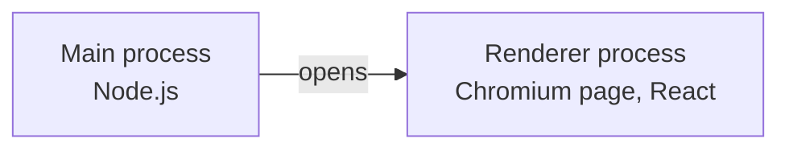
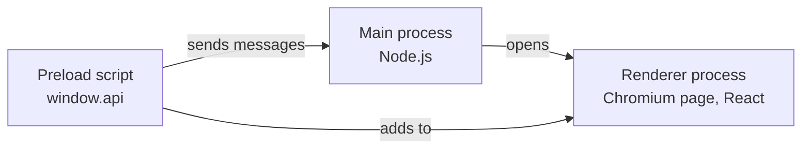
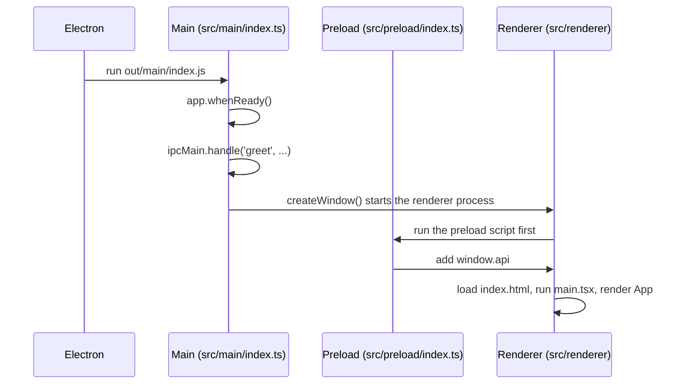
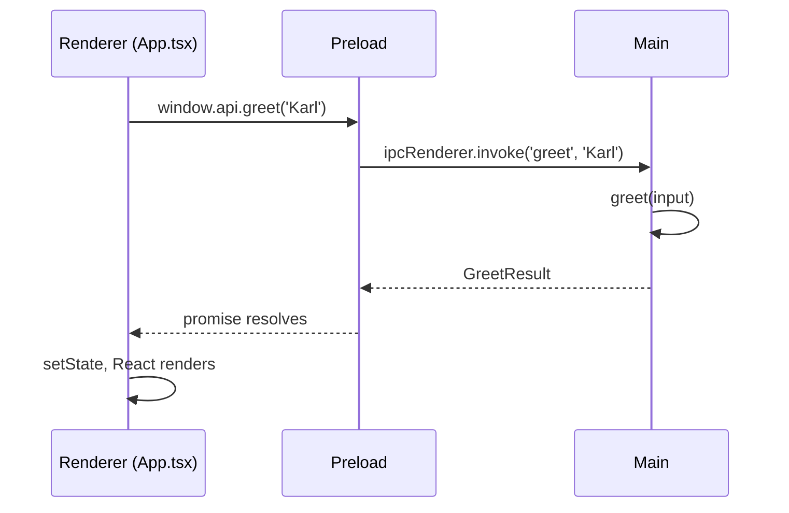

# How the app works

Electron is a Chromium browser and a Node.js runtime packaged as one desktop app. The page you see runs in the browser half. Anything that touches the machine, such as reading a file, runs in the Node half. Most of what makes Electron different from a website is how those two halves talk to each other, so this doc follows one message through the app.

## Electron runs your code in separate processes

The app starts in the **main process**. It is a Node.js program with full access to the machine, and it owns the app lifecycle and the windows. `src/main/index.ts` is its entry point.

The main process opens a `BrowserWindow`. Chromium then starts a **renderer process** to show the page in that window. The renderer is a web page. `src/renderer/` holds that page, and React runs there.



The two are operating system processes, so they share no memory. A variable in one does not exist in the other. The left half of the running app shows `typeof process` as `undefined`, while the right half shows a `pid` that came from main.

The renderer has no Node because of three settings in `createWindow`. `sandbox: true` and `nodeIntegration: false` keep Node out of the page. `contextIsolation: true` keeps the preload script's JavaScript separate from the page's JavaScript. These settings matter because a page can run code you did not write, for example through a bug that injects HTML. In this app, the same bug cannot read the user's files.

## The preload script connects the two sides

The page still needs to ask main for things. The **preload script** in `src/preload/index.ts` runs in the renderer process before the page loads, and it can use a small set of Electron APIs that the page cannot. It adds one object, `window.api`, to the page.



`window.api` has exactly one function, `greet`. The preload script never gives the page `ipcRenderer` itself. If it did, the page could send any message on any channel, and the sandbox would protect much less. Each function on `window.api` is a capability you chose to grant, and the smoke test fails if a second key appears.

## Follow the code from launch to reply

This section traces the code in the order it runs. Each step names the file and function, so you can open them side by side.

### Startup



1. `pnpm start` builds the app and starts Electron in the project folder. Electron reads `"main": "./out/main/index.js"` in `package.json`. That file is the compiled `src/main/index.ts`.

2. The top level of `src/main/index.ts` only registers callbacks. Electron cannot create windows until it is ready, so the work waits for `app.whenReady()`:

	```ts
	app.whenReady().then(() => {
	  ipcMain.handle(GREET_CHANNEL, (_event, input: unknown) => greet(input))
	  createWindow()
	  ...
	})
	```

	The handler is registered before the window exists, so it is in place before any page code can call it.

3. `createWindow` creates the window and names the preload script:

	```ts
	const window = new BrowserWindow({
	  ...
	  webPreferences: {
	    preload: join(__dirname, '../preload/index.js'),
	    contextIsolation: true,
	    sandbox: true,
	    nodeIntegration: false,
	  },
	})
	```

	It then loads the page. Under `pnpm dev` the page comes from the Vite dev server at `ELECTRON_RENDERER_URL`. In a built app it comes from `out/renderer/index.html` on disk.

4. Chromium starts a renderer process for the window. Before any page script runs, the renderer runs `src/preload/index.ts`:

	```ts
	const api: DesktopApi = {
	  greet: (name) => ipcRenderer.invoke(GREET_CHANNEL, name),
	}

	contextBridge.exposeInMainWorld('api', api)
	```

	After this line, `window.api.greet` exists in the page.

5. The renderer loads `src/renderer/index.html`. It applies the Content Security Policy, loads `styles.css`, and runs `main.tsx`, which mounts React:

	```ts
	createRoot(document.getElementById('root')!).render(
	  <StrictMode>
	    <App />
	  </StrictMode>,
	)
	```

6. React calls the `App` function for the first time. The state is `{ status: 'idle' }`, the main side shows dashes, and the chip shows `Nothing sent yet`. Under `pnpm dev`, `StrictMode` calls `App` twice to catch side effects. That is expected and does not happen in a built app.

### One call

You type `Karl` and click **Send to main**.



1. The form submits, and `handleSubmit` in `App.tsx` runs:

	```ts
	async function handleSubmit(event: FormEvent) {
	  event.preventDefault()
	  setState({ status: 'waiting' })
	  setState({ status: 'done', result: await window.api.greet(name) })
	}
	```

	`preventDefault` stops the browser from reloading the page, which is the default for a form. `setState({ status: 'waiting' })` makes React render again with the button disabled.

2. `window.api.greet('Karl')` is the function from the preload script. It calls `ipcRenderer.invoke('greet', 'Karl')`. IPC means inter-process communication. Electron copies the arguments into a message and sends it to the main process. `invoke` returns a promise right away, so `handleSubmit` pauses at `await`.

3. In the main process, Electron finds the handler registered for `'greet'` and calls it with the copied argument:

	```ts
	ipcMain.handle(GREET_CHANNEL, (_event, input: unknown) => greet(input))
	```

	`_event` describes the sender, such as which window sent the message. This app does not use it.

4. `greet` checks the input and builds the reply:

	```ts
	function greet(input: unknown): GreetResult {
	  if (typeof input !== 'string' || input.trim() === '') {
	    return { ok: false, error: 'Name must be a non-blank string.' }
	  }

	  return {
	    ok: true,
	    message: `Hello, ${input.trim()}!`,
	    runtime: { pid: process.pid, platform: process.platform, ... },
	  }
	}
	```

	`process` here is the main process's Node `process`, so `pid` is the main process's ID.

5. Electron copies the returned object back to the renderer. The `invoke` promise resolves, the `await` finishes, and `handleSubmit` calls `setState({ status: 'done', result })`.

6. React calls `App` again with the new state. These lines pick out what to show:

	```ts
	const result = state.status === 'done' ? state.result : null
	const runtime = result?.ok ? result.runtime : null
	```

	`crossingText(state)` returns `Hello, Karl!` for the chip. The main side fills in each value from `runtime`. React compares the new output with the page and changes only the text that differs.

If you submit a blank name, the same path runs. `greet` returns `{ ok: false, error }` at step 4, `runtime` is `null`, and the chip shows the error with the `failed` style.

Every call is asynchronous, because the reply comes from another process. Everything that crosses is copied, so only plain data works. You can send objects and arrays, but a class instance loses its methods and a function throws an error.

## The contract lives in one file

`src/shared/ipc.ts` holds the channel name and the types, and all three parts import it. If you rename a field in `GreetResult`, `pnpm typecheck` fails in every file that uses the old name.

Types do not exist at runtime, though. TypeScript removes them during the build, so `greet(name: string)` promises nothing about what actually arrives in main. That is why the handler in main takes `input: unknown` and checks it. Treat the renderer the way a server treats a browser, as a source of input that you do not trust. The smoke test calls `window.api.greet(123)` to prove that the check runs.

`GreetResult` is a union of a success shape and a failure shape. A blank name is an expected outcome, so `greet` returns `{ ok: false, error }` and does not throw. TypeScript then refuses to let `App.tsx` read `result.message` until the code has checked `result.ok`.

## React draws the page from state

A React component is a function that returns what the page looks like for the current state. You change the state with `setState`, and React updates the page to match. No code in `App.tsx` edits the page directly.

`GreetState` has three values: `idle`, `waiting`, and `done`. One union is better here than separate `isLoading` and `hasResult` booleans, because booleans allow combinations that mean nothing. `crossingText` switches on the state to pick the text in the center chip, and the same state disables the button during `waiting`.

## electron-vite builds three separate bundles

The three parts run in different places, so `electron.vite.config.ts` has three sections and the build writes three folders:

| Part | Source | Output | Runs in |
| --- | --- | --- | --- |
| Main | `src/main/` | `out/main/` | Node.js |
| Preload | `src/preload/` | `out/preload/` | Sandboxed renderer process |
| Renderer | `src/renderer/` | `out/renderer/` | Chromium |

`pnpm dev` serves the renderer from a local Vite server and sets `ELECTRON_RENDERER_URL`, so `createWindow` loads that URL. CSS and React changes then appear without a restart. The built app has no server, so `createWindow` loads `out/renderer/index.html` from disk.

Type checking is split the same way. `tsconfig.node.json` covers main, preload, and the smoke test, and it knows Node's types. `tsconfig.web.json` covers the renderer and knows the DOM's types but not Node's. If you write `process.env` in the renderer, `pnpm typecheck` fails with `TS18046`, which matches what would happen at runtime.

## Four details in this code look odd

Each of these came from a problem found while building the app:

- **`App.tsx` reads `globalThis.require`, not `require`.** The bundler replaces a bare `require` with its own helper, so `typeof require` showed `function` in the built page. The value looked like a sandbox failure, but it came from the bundle.
- **`RuntimeInfo.platform` is `string`.** The type `NodeJS.Platform` would pull Node's global types into the renderer's type check, and `process.env` would then compile there.
- **`package.json` has no `"type": "module"`.** A sandboxed preload script must be CommonJS. With an ES module preload, `window.api` was `undefined` and the page failed.
- **The stylesheet is a `<link>` in `index.html`.** A CSS import in JavaScript makes Vite's dev server add `<style>` tags, and the page's Content Security Policy allows only `style-src 'self'`. That conflict is inferred and has not been tested. The `<link>` form ran with no policy violations.

## Add a call by editing four files

To add a capability, change these files in order:

1. In `src/shared/ipc.ts`, add a channel name and the result type, and add the method to `DesktopApi`.
2. In `src/main/index.ts`, write the function, validate its input, and register it with `ipcMain.handle`.
3. In `src/preload/index.ts`, add the method to `api`. TypeScript reports an error until you do, because `api` must match `DesktopApi`.
4. In `src/renderer/src/App.tsx`, call `window.api.yourMethod()`.

## How session export fits this structure

This section is a plan, and none of it exists yet. The future app moves AI coding agent sessions between computers. Session files live on disk, so reading and writing them belongs in main. The renderer asks for a list, shows it, and sends back the user's choice.

The validation rule becomes more important at that point. A function that takes a file path from the renderer must treat that path as untrusted input, or a compromised page could read any file. A safer `window.api` offers `listSessions()` and `exportSession(id)`, with main working out the real paths itself.

Packaging is also missing. `pnpm build` compiles the code, but it does not make an installer for macOS, Windows, or Linux.
